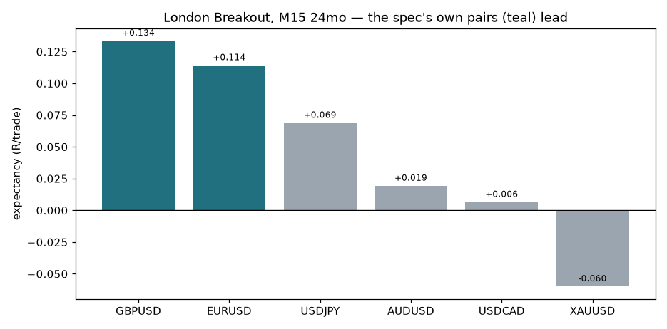

# XAUUSD Trading Bot — MT5 Framework, Strategy Engines and Research

An MT5 trading system for Linux (MetaTrader 5 under Wine in Docker, driven
from Python) with three parts:

1. **Execution framework** — broker connectivity, order lifecycle, risk gates,
   journaling, crash recovery and a dashboard, replicated from the
   `Scraper-forex-bot` framework and unit-tested.
2. **Strategy engines** behind a stable interface — an XAUUSD five-gate scalping
   engine and a EURUSD London Breakout engine (`src/strategy/`).
3. **Research** (`research/`) — backtests with costs, parameter sweeps and
   adversarial out-of-sample tests, plus a pre-registered demo forward test.

> **Status:** demo accounts only. No strategy here has shown a statistically
> robust live edge. Live order placement is off by default
> (`STRATEGY_GATE_ENABLED=false`).



---

## Architecture

Clean/layered architecture. Dependencies point inward; the framework depends
only on abstract contracts at the strategy boundary.

```
                         ┌──────────────────────────────────────┐
   MT5 Terminal (Wine)   │  ZoneBotBridge.mq5 (Expert Advisor)   │
   + Python in one        │  PUB tcp://127.0.0.1:5556 (ticks,     │
   Docker container       │  candle closes, trade events)         │
                         └───────────────────┬──────────────────┘
                                              │ ZeroMQ (Wine loopback)
                                              ▼
┌─────────────────────────────────────────────────────────────────────────┐
│  main_stream.py  — event loop (TICK / CANDLE_CLOSED / TRADE / HEARTBEAT)  │
│      build_engine()  ─────────────►  IStrategyEngine   (THE seam)         │
│      build_guardian() ────────────►  ITradeGuardian    (THE seam)         │
└───────────────┬───────────────────────────────────────┬──────────────────┘
                │                                         │
        APPLICATION layer                          STRATEGY boundary
   ┌────────────┴─────────────┐            ┌──────────────┴───────────────┐
   │ ExecutionService          │            │ interfaces.py  (contracts)   │
   │   • order placement       │            │   StrategySignal             │
   │   • TP1/TP2 tiering        │◄───────────┤   IStrategyEngine            │
   │   • time-exit, MFE         │  Guardian  │   ITradeGuardian             │
   │   • position sizing        │  actions   │   GuardianAction / Input     │
   │   • broker-truth P&L       │            ├──────────────────────────────┤
   │ EntryGate (risk gates)     │            │ placeholder_engine.py  (no   │
   │ MarginManager (portfolio)  │            │   signals)                    │
   │ NewsManager / Scheduler    │            │ placeholder_guardian.py (no  │
   │ EmailService / TickAnalytics│           │   exits)                      │
   └────────────┬─────────────┘            └──────────────────────────────┘
                │
       INFRASTRUCTURE layer
   ┌────────────┴───────────────────────────────────────────────────────┐
   │ MT5Gateway (connect/reconnect, orders, margin, history)             │
   │ MT5TradeRepository · MT5MarketDataRepository · BrokerClock/NTP      │
   │ Streaming: ZmqFeed · CandleBuilder · StreamingMarketDataRepo        │
   │ News: ForexNewsClient · MT5NewsClient · CompositeNewsClient · cache │
   │ SpreadCalculator · TradeJournal · CheckpointService · CleanupService│
   │ TimeSync · Dashboard API (Flask)                                    │
   └─────────────────────────────────────────────────────────────────────┘
                │
          DOMAIN layer
   ┌────────────┴───────────────────────────────────────────────────────┐
   │ entities (Candle, Trade, TradeSignal, Direction, …)                 │
   │ value_objects (PipCalculator, BrokerCost, RiskParameters)           │
   │ repositories (IMarketDataRepository, ITradeRepository, …)           │
   └─────────────────────────────────────────────────────────────────────┘
```

### What is included (the framework — fully implemented)

| Area | Component(s) |
|------|--------------|
| **MT5 connectivity** | `MT5Gateway` — attach-without-relogin, auto-reconnect on every call, UTC-offset detection, filling-mode resolution |
| **Order execution** | place / close / partial-close / modify-SLTP, broker stop-level pre-flight nudging, fill-slippage handling |
| **Trade modification** | structural/defensive SL trailing applied mechanically from guardian decisions, TP1/TP2 profit-lock |
| **Position management** | TP1/TP2 tiered partial exits, time-based exit, MFE tracking, open-trade reconciliation with broker |
| **Session handling** | per-symbol UTC session windows, NTP-calibrated broker clock, broker UTC offset auto-detect |
| **Connection recovery** | reconnect with backoff, ZMQ feed auto-restart, checkpoint restore on restart, clean SIGTERM shutdown |
| **Data flow** | ZeroMQ tick/candle/trade stream, `CandleBuilder` aggregation, streaming repo with MT5 fallback |
| **Risk management hooks** | news, session, tick-velocity, daily-drawdown circuit breaker, portfolio allocation, margin level, spread/cost, expected-value, anti-duplicate, min-SL, R:R, money-risk ceiling, position sizing |
| **Logging / monitoring** | structured logging, `TradeJournal` (broker-truth P&L), `TickAnalytics` execution tracking, Flask dashboard |
| **Operations** | `Scheduler` (cleanup/analytics), `EmailService` alerts, `CheckpointService`, `CleanupService`, log/cache retention |
| **Deployment** | Docker (`gmag11/metatrader5_vnc`), Wine, `override_start.sh`, EA injection tools |

### Strategy engines (wired in `src/main_stream.py`)

| Engine | Symbol | Logic |
|--------|--------|-------|
| `XAUUSDStrategyEngine` + `XAUUSDTradeGuardian` (`xauusd_engine.py`) | XAUUSD | Five gates: session window, ATR regime, EMA(20/50) trend, VWAP deviation, liquidity sweep with close-back |
| `EURUSDStrategyEngine` + `EURUSDTradeGuardian` (`eurusd_engine.py`) | EURUSD | London Breakout |
| `MultiSymbolEngine` / `MultiSymbolGuardian` (`multi_engine.py`) | both | Routes each symbol to its engine |
| `PlaceholderStrategyEngine` / `PlaceholderTradeGuardian` | — | No-op reference implementations of the interfaces |

The XAUUSD engine has not been validated by the research below; treat it as
untested.

---

## The strategy boundary

Everything the strategy must provide lives in **`src/strategy/interfaces.py`**:

- **`StrategySignal`** — the entry contract: direction, confidence, proposed
  entry, and the proposed `stop_loss` / `take_profit_1` / `take_profit_2`
  (the entry/exit math is the strategy's job). The framework's `EntryGate`
  validates and sizes it; it never invents levels.
- **`IStrategyEngine`** — `seed / on_candle / push_tick / evaluate`. `evaluate()`
  returns a `StrategySignal` or `None`. Optional `get_structure()` returns an
  opaque object handed back to the guardian.
- **`ITradeGuardian`** — `evaluate(GuardianInput) -> [GuardianAction]`. Decides
  whether to trail SL, partially close, or close each open trade. The
  `ExecutionService` applies the returned actions mechanically and journals them.

### Plugging in a strategy

1. Implement `IStrategyEngine` (and optionally `ITradeGuardian`) in a new module
   under `src/strategy/`.
2. Swap the two factory functions in `src/main_stream.py`:

   ```python
   def build_engine(symbols) -> IStrategyEngine:
       from src.strategy.my_engine import MyStrategyEngine
       return MyStrategyEngine(symbols=symbols)

   def build_guardian() -> ITradeGuardian:
       from src.strategy.my_engine import MyTradeGuardian
       return MyTradeGuardian()
   ```

   The current wiring (`XAUUSDStrategyEngine` and `EURUSDStrategyEngine` via
   `MultiSymbolEngine`) is a working example.

3. Set `STRATEGY_GATE_ENABLED=true` in `.env` when you are ready to place live
   trades. Nothing else in the framework changes.

See **`docs/STRATEGY_INTEGRATION.md`** for a step-by-step guide and a minimal
reference implementation.

---

## Research

Standalone modules under `research/`; they do not touch the live framework.
Results are committed as JSON (`research/box_theory/results/`) and Markdown
reports (`research/box_theory/report/`); raw price data is gitignored.

| Study | Result | Report |
|-------|--------|--------|
| Box Theory (fade previous-day high/low on a rejection candle) | Rejected: 87% of 16,096 configurations with ≥30 trades lose money | `BOX_THEORY_REPORT.md` |
| London Breakout, M15, 24 months, 6 pairs, with costs (in-sample) | Pooled +0.075 R/trade, n = 1,230, PF 1.19, p = 0.005. GBPUSD +0.134 R, EURUSD +0.114 R, XAUUSD −0.060 R | `LONDON_BREAKOUT_REPORT.md` |
| London Breakout adversarial tests | Survives most single stresses; fails under combined cost +50%, slippage +1 pip and the most recent 12 months (+0.012 R, p = 0.39) | `LB_ADVERSARIAL_REPORT.md` |
| Demo forward test (`research/forward_test/`) | Running; pre-registered GO/REJECT criteria in its README | — |

The edge found is on FX pairs, not gold, and it weakens under realistic
stress. That is why the next step is a demo forward test, not live trading.

---

## Running

### Docker (recommended — bundles MT5 + Wine)

```bash
cp env.example .env          # then edit credentials in .env
docker compose up -d
# Dashboard:  http://localhost:8002
# MT5 (VNC):  http://localhost:3002
```

### Local (requires an MT5 bridge — `mt5linux` or Windows `MetaTrader5`)

```bash
pip install -r src/requirements.txt
export TRADING_ID=... MT5_PASSWORD=... MT5_SERVER=...
python -m src.main_stream
```

### Tests (no broker needed)

```bash
python -m tests.test_framework                      # framework: 11 tests
cd research && python -m box_theory.tests.test_core  # research engine: 33 tests
cd research && python -m box_theory.tests.test_sneaky
```

The research tests need numpy and pandas.

---

## Project layout

```
src/
  config.py                     # all settings (framework + strategy-engine placeholders)
  main_stream.py                # event loop + build_engine()/build_guardian() seams
  domain/                       # entities, value objects, repository interfaces
  infrastructure/               # MT5 gateway, repos, streaming, news, journal, EA
    mt5_bridge/mt5_gateway.py
    mt5_bridge/ea/ZoneBotBridge.mq5
    stream/                     # zmq_feed, candle_builder, streaming repo
  application/                  # execution_service, entry_gate, margin_manager,
                                # news_manager, scheduler, email_service, tick_analytics
  api/server.py                 # Flask dashboard
  strategy/
    interfaces.py               # ◄── THE strategy/framework contracts
    xauusd_engine.py            # XAUUSD five-gate engine + guardian
    eurusd_engine.py            # EURUSD London Breakout engine + guardian
    multi_engine.py             # per-symbol routing
    placeholder_engine.py       # no-op IStrategyEngine
    placeholder_guardian.py     # no-op ITradeGuardian
research/
  box_theory/                   # backtest engine, sweeps, robustness, reports, tests
  forward_test/                 # London Breakout demo forward test
tests/test_framework.py
docker-compose.yml · override_start.sh · env.example
docs/STRATEGY_INTEGRATION.md
```

---

## Safety defaults

- **Observation mode** by default (`STRATEGY_GATE_ENABLED=false`): the bot
  logs every signal but places no orders until you enable it.
- **Fail-closed** everywhere: missing margin/pip-value/cost data rejects the
  trade rather than guessing.
- Use a **demo account** until your strategy is validated.
