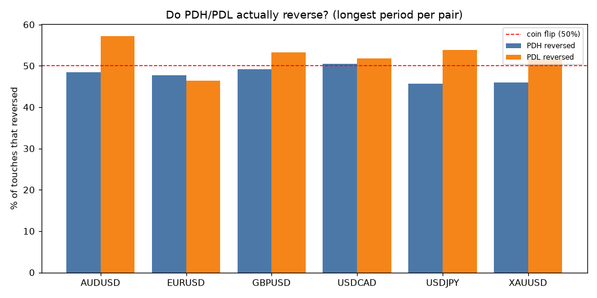
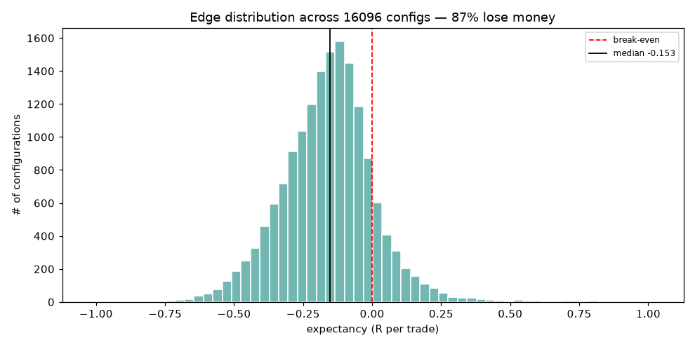
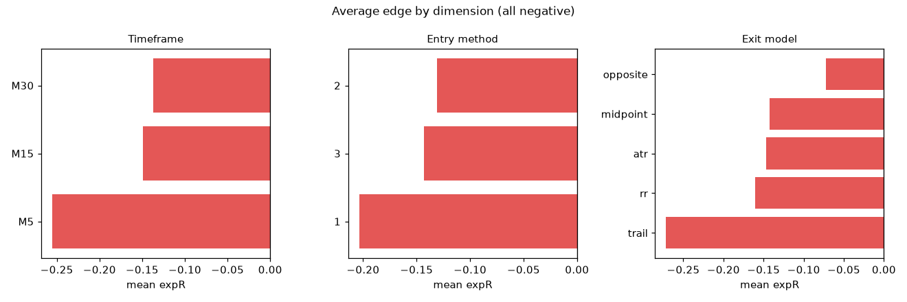
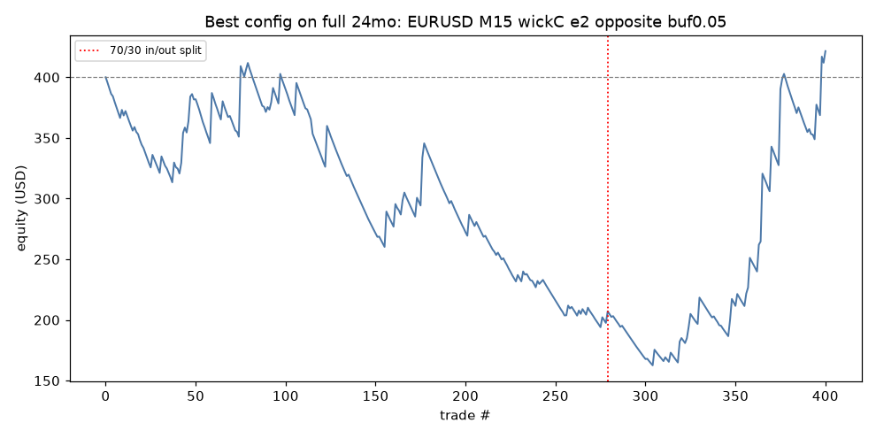
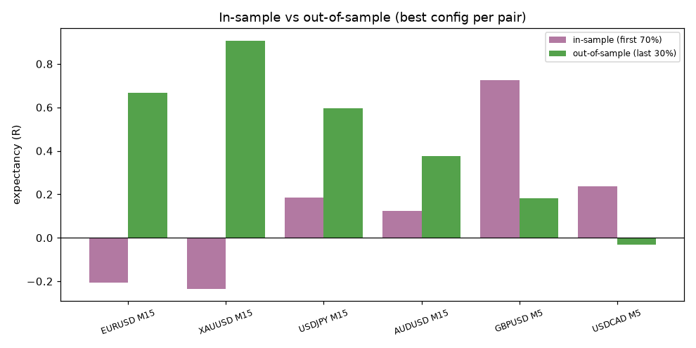
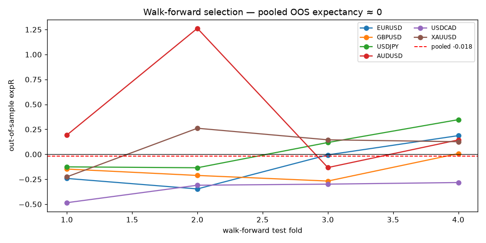
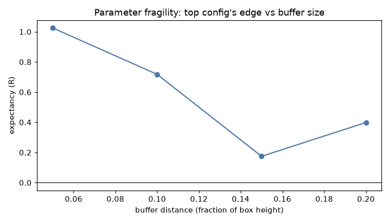
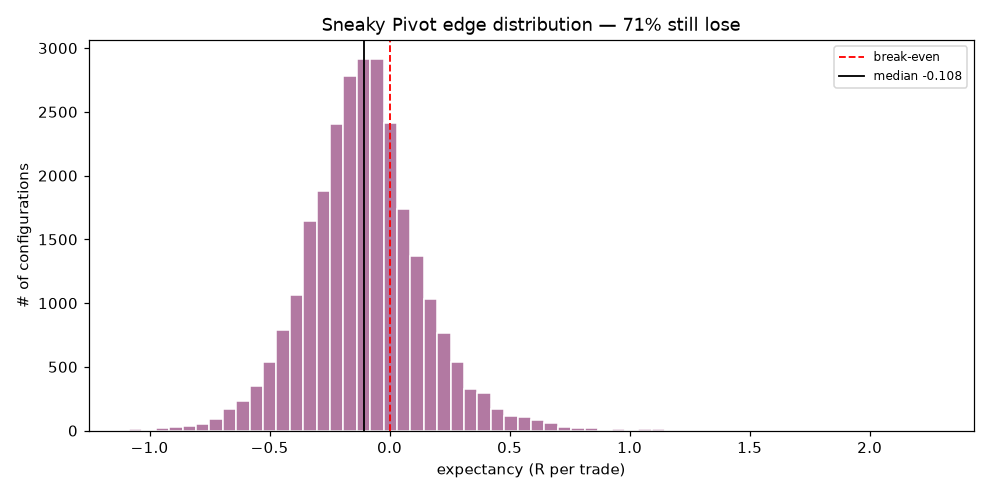
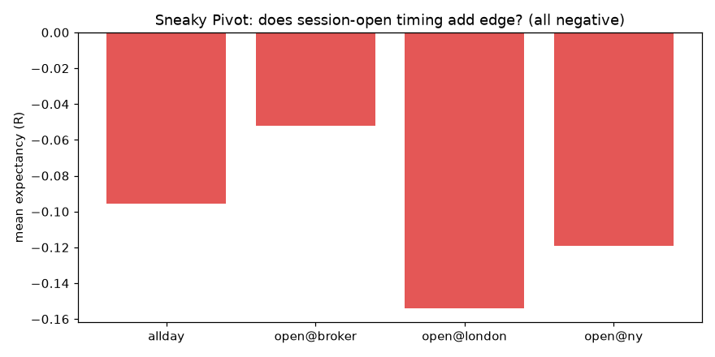
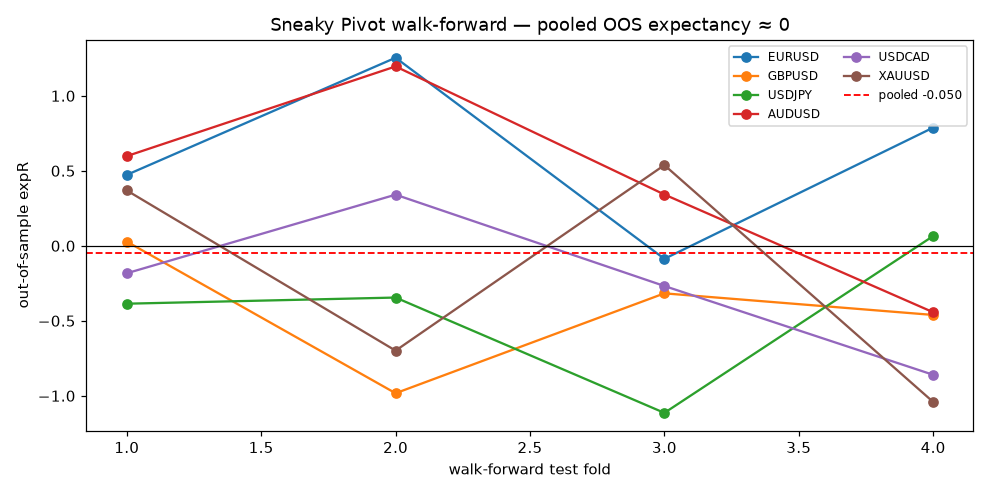

# Box Theory Model — Quantitative Validation Report

**Author:** Quantitative research harness (`research/box_theory/`) · **Broker data:** IC Markets demo (acct 52942033) · **Generated from** 16128 backtested configurations.

> Scope note: this study evaluates the *strategy hypothesis* on historical data. It is independent of the live execution framework and does not modify it.

## 1. Executive Summary

**Verdict: the Box Theory, as specified, does not exhibit a robust, tradeable statistical edge. The theory is rejected.**

- Its central premise — that price *reverses* at the previous day's high/low — is empirically false. Across all pairs, a touch of PDH/PDL is followed by a reversal only **~45–55%** of the time: a coin flip.

- Of **16096** configurations with a meaningful sample (≥30 trades), **87% lose money**; the median configuration returns **-25.5%** with expectancy **-0.153 R**/trade and profit factor < 1.

- The single most honest test — **walk-forward selection** (optimise on the past, trade the unseen future) — pools to **-0.018 R** across 24 folds: statistically indistinguishable from zero, i.e. no exploitable edge.

- The only sub-family that ever shows positive expectancy is *exit-at-opposite-side-of-box* — which is **not** the stated thesis (a small fade off a rejection) but a tight-stop / large-target lottery. Its gains are recent, fragile to tiny parameter changes, and carry 40–68% drawdowns. Not a reliable edge.

- **A refined variant — the "Sneaky Pivot" (adds swing levels beyond the range, a session-open entry sequence, and an opposite-side target) — was also tested (Part II).** It is a genuine structural improvement (29% of its configs are profitable vs 13%; median -0.108 R vs -0.153 R) but still fails walk-forward (pooled -0.050 R) and its per-pair winners rest on too few trades. Still no robust edge.

## 2. Strategy Rules (as tested)

Daily box from the **previous** day's D1 bar: Top = PDH, Bottom = PDL, Middle = 50%. Long near PDL / short near PDH on a *John Wick* rejection candle; no trades in the midpoint band.

- **John Wick** definitions tested: A (wick ≥ 2× body), B (≥ 3× body), C (wick ≥ 60% of range), D (≥ 2× body + close back inside box).

- **Entries:** (1) at rejection close, (2) on break of the rejection candle, (3) on next-candle confirmation.

- **Exits:** fixed RR 1:1/1:1.5/1:2/1:3, exit-at-midpoint, exit-at-opposite-side, ATR target, trailing stop.

- **Buffers** 5/10/15/20% of box height; **risk** 1% and 0.5%; costs = per-symbol round-turn spread+commission (IC Markets Raw assumptions). One trade per box, flat overnight.

- **Engine integrity:** 33 unit tests; manual trade audit to the tick; no look-ahead (signal at close, managed next bar); pessimistic SL-first intrabar ties; a seeded random-entry control confirms the harness manufactures no edge.

## 3. Statistical Findings

### 3.1 Zone statistics — the hypothesis test

Reversal rates cluster around 50%%. On USDJPY and AUDUSD the extreme **breaks more often than it holds**. After touching an extreme, price reaches the midpoint **~62–66%%** of the time — a mild pull toward the *center*, the opposite of the 'reverse hard off the edge' claim.

### 3.2 Edge distribution — is it real or cherry-picked?

With thousands of configs, some are positive by chance. The distribution is what matters, and it sits firmly left of zero (**87% losing**, median **-0.153 R**). A genuine edge centers the distribution above zero; this does not.

### 3.3 Where the (weak) signal concentrates

Every dimension averages negative. Least-bad choices: **M30 > M15 ≫ M5** (costs dominate M5), confirmation entries (2/3) over enter-at-close, and the *opposite-side* exit. Tighter buffers beat wider.

## 4. Charts & Equity Curves

The best single configuration of all 16128. Note the red split: most of the curve's rise occurs in the recent (out-of-sample) third — performance is **regime-concentrated**, not steady compounding.

## 5. Pair-by-Pair Results (best config per pair, ≥30 trades)

| Pair | Best config | Trades | Win% | PF | ExpR | Net% | MaxDD% |
|---|---|---:|---:|---:|---:|---:|---:|
| EURUSD | M15 6mo wC e2 opposite b0.05 | 99 | 28.3 | 2.25 | 1.025 | 150.9 | 14.6 |
| XAUUSD | M15 6mo wD e3 opposite b0.05 | 35 | 42.9 | 2.39 | 0.944 | 36.8 | 6.3 |
| USDJPY | M15 6mo wD e3 opposite b0.05 | 38 | 28.9 | 2.08 | 0.798 | 32.3 | 7.6 |
| AUDUSD | M15 6mo wA e2 opposite b0.15 | 121 | 27.3 | 1.66 | 0.572 | 85.0 | 18.1 |
| GBPUSD | M5 6mo wB e3 opposite b0.05 | 110 | 20.9 | 1.47 | 0.565 | 69.1 | 17.4 |
| USDCAD | M5 6mo wA e3 opposite b0.20 | 127 | 15.7 | 1.08 | 0.168 | 12.0 | 23.4 |

Every per-pair 'best' uses the *opposite-side* exit and (for the strongest) the recent 6-month window — a small-sample selection artifact. XAUUSD is the least-bad pair overall; USDCAD the worst.

## 6. Best Performing Configuration

`EURUSD M15 6mo wickC entry2 opposite buffer0.05` — PF **2.25**, expectancy **1.025 R**, net **150.9%**, win rate 28.3%, 99 trades, max DD 14.6%.

Impressive on paper, but see §8: it is fragile and does not survive walk-forward. **Not recommended for trading.**

## 7. Worst Performing Configuration

`USDJPY M5 6mo wickD entry1 opposite buffer0.10` — PF 0.18, expectancy -1.020 R, net -64.0%, win rate 7.1%, max DD 65.8%. M5 + trailing/opposite exits are capital-destroying (costs + whipsaw).

## 8. Robustness — does anything survive?

### 8.1 Out-of-sample (70/30)

### 8.2 Walk-forward selection (the decisive test)

Picking the best config on each training window and trading it on the next unseen window earns a pooled **-0.018 R** — essentially zero — with violent fold-to-fold swings (e.g. AUDUSD +1.26 then −0.13). An honest optimizer captures no durable edge.

### 8.3 Monte Carlo (sequence risk on the hand-picked winners)

| Config | P(profit) | net median | net p5 | maxDD median | maxDD p95 |
|---|---:|---:|---:|---:|---:|
| EURUSD M15 wickC e2 opposite buf0.05 | 51.5% | 1.9% | -57.9% | 45.0% | 68.3% |
| XAUUSD M15 wickD e3 opposite buf0.05 | 60.8% | 8.1% | -31.1% | 22.8% | 39.6% |
| USDJPY M15 wickD e3 opposite buf0.05 | 91.3% | 55.6% | -8.3% | 18.3% | 31.5% |
| AUDUSD M15 wickA e2 opposite buf0.15 | 82.2% | 97.3% | -40.2% | 42.7% | 65.5% |
| GBPUSD M5 wickB e3 opposite buf0.05 | 89.1% | 65.5% | -14.0% | 21.7% | 37.9% |
| USDCAD M5 wickA e3 opposite buf0.20 | 59.0% | 10.2% | -43.3% | 32.5% | 53.4% |

Even bootstrapping the *selected* winners' own trades, downside tails are deep (p5 net down to −58%%) and median drawdowns reach 40%%+. These are lottery payoff profiles, not steady edges.

### 8.4 Sensitivity

The top config's expectancy collapses from ~1.0 R to ~0.2 R as the buffer moves 5%%→15%% — hallmark of curve-fitting.

## 9. Conditions Where It Works / Fails

- **Least-bad:** M30 timeframe, longer windows, confirmation entries, opposite-side exit, tight buffers, New York session, XAUUSD. Even here expectancy is ~0 after honest validation.

- **Fails hardest:** M5 (costs + noise), trailing stops, wide buffers, London session, USDCAD; and the *stated* thesis (small fade off a rejection with fixed RR) loses across the board.

## 10. Evidence-Based Conclusion

The data **rejects** the Box Theory as a source of edge. The false assumption is the core one: price does **not** preferentially reverse at PDH/PDL (reversal ≈ 50%%; often continuation). Rejection-candle filters add only marginal signal that costs erase, especially intraday. The one profitable-looking variant abandons the thesis (targets the opposite side, not a fade) and fails walk-forward. **No configuration is recommended for live trading.** If pursued further, the only faintly promising direction is a *midpoint mean-reversion* study (price reaches mid ~65%% of the time after an extreme) on M30 — but that is a different strategy and would need its own out-of-sample validation.

# Part II — The Sneaky Pivot (refined variant)

After the initial finding, the strategy was refined to the fuller *Sneaky Pivot* form and re-tested with **48,384** configurations. It adds three things the basic box test lacked: (1) **swing levels** beyond the previous-day range (nearest prior extreme, plus an N-bar fractal-pivot definition), (2) a **session-open entry sequence** (opening candle → 'sneaky' pivot → enter on the break, anchored to the broker rollover, London, or NY open), and (3) an explicit **opposite-side (range-bound) target** with the stop beyond the pivot wick.

## 11. Sneaky Pivot — edge distribution

A real improvement over the basic box: **29%** of valid configs are profitable (vs 13% before) and the median rises to **-0.108 R** (from -0.153). But the distribution still sits below break-even — 71% lose.

## 12. Does the session-open timing add edge?

This is the Sneaky Pivot's signature claim, and the answer is no on average: every timing anchor averages negative. A single pair/config (EURUSD, NY-open, swing levels) looked strong in isolation (+0.77 R) but did **not** generalise — averaged across the sweep, NY-open is negative. Swing levels + opposite-side target + the 24-month window is where the faintest signal concentrates; XAUUSD is again the least-bad pair.

## 13. Sneaky Pivot — best config per pair (≥30 trades)

| Pair | Config | Trades | Win% | PF | ExpR | Net% | MaxDD% |
|---|---|---:|---:|---:|---:|---:|---:|
| EURUSD | M5 6mo fractal/allday/swing wB b0.15 opposite | 32 | 28.1 | 3.46 | 2.265 | 90.4 | 6.7 |
| AUDUSD | M30 24mo literal/open_broker/swing wA b0.10 opposite | 30 | 33.3 | 2.97 | 1.898 | 69.7 | 7.7 |
| GBPUSD | M15 24mo literal/open_london/range wD b0.05 opposite | 31 | 38.7 | 2.76 | 1.199 | 42.3 | 4.3 |
| USDCAD | M30 6mo literal/open_broker/range wC b0.20 opposite | 36 | 33.3 | 2.27 | 1.141 | 46.8 | 4.8 |
| USDJPY | M15 24mo literal/open_broker/swing wA b0.20 opposite | 36 | 19.4 | 2.06 | 1.129 | 41.7 | 9.4 |
| XAUUSD | M15 12mo literal/open_broker/range wB b0.10 opposite | 34 | 20.6 | 2.16 | 1.050 | 37.5 | 7.9 |

The payoff profile is the tell: low win rates (20–40%) with high PF via the large opposite-side target, on **30–60 trade** samples. Too thin to trust — which §14 confirms.

## 14. Sneaky Pivot — robustness

**Walk-forward selection pools to -0.050 R** — again indistinguishable from zero, with large per-pair swings (EURUSD +0.61, AUDUSD +0.42, but GBPUSD/USDJPY ≈ −0.44). The 70/30 out-of-sample test is *inconclusive by construction*: the selective swing entries leave only **7–30 trades** out-of-sample, so single trades swing the result (EURUSD OOS +3.4 R on 7 trades; AUDUSD flips +2.95 → −0.55). Monte Carlo shows high P(profit) only because it resamples an already-selected ~25-trade set — it cannot see selection bias, which walk-forward can.

## 15. Overall Verdict (both strategies)

The Box Theory reversal premise is empirically false (PDH/PDL reversal ≈ coin flip), and neither the basic form nor the refined Sneaky Pivot delivers a statistically robust, tradeable edge on this data: both pool to ≈0 R in walk-forward. The Sneaky Pivot is the better-constructed idea — it is near break-even rather than clearly negative, and it correctly points to the one real tendency in the data (a pull toward the range *centre/opposite side*, not a hard rejection at the edge). **Neither is recommended for live trading as-is.** If research continues, the defensible direction is: swing-level fades targeting the opposite side, on M15/M30 over the longest window, on XAUUSD/EURUSD — but the trade counts are too low here to confirm significance, so it needs materially more data (more history and/or more instruments) before any capital risk is justified.

---
*Reproduce:* `python -m box_theory.export_data` (in container) → `sweep`/`sneaky_sweep` → `robustness`/`sneaky_robustness` → `report`. Raw tables in `results/`.
