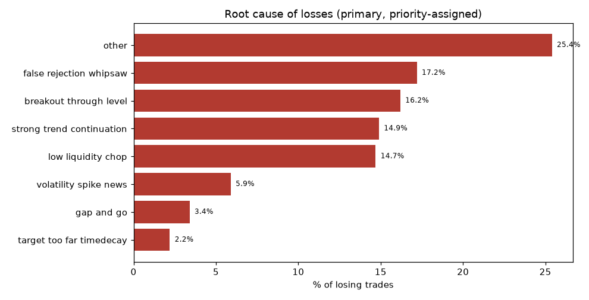
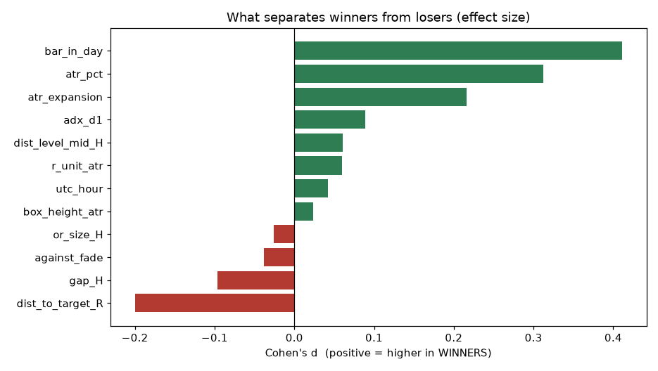
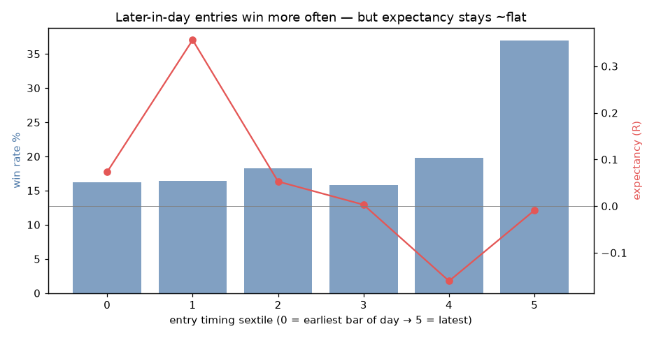
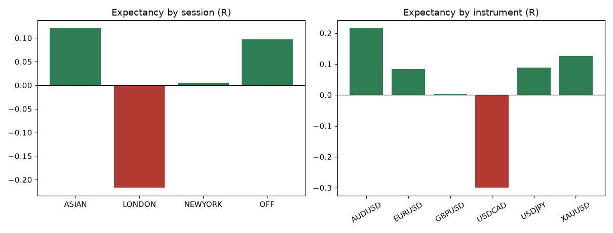
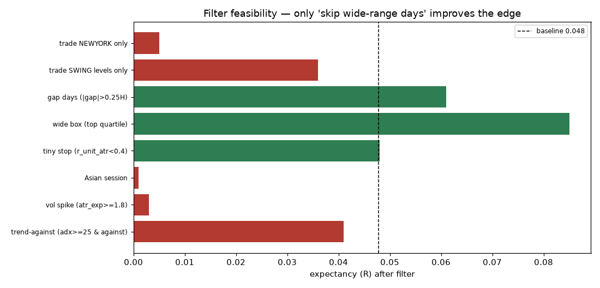

# Sneaky Pivot — Forensic Trade Analysis

A trade-level root-cause investigation of **why** the strategy behaves as it does, on a fixed canonical config pooled across all six instruments for statistical power: **M15, 24 months, literal swing levels, range+swing, all-day entry, wick B, 10% buffer, opposite-side target, one trade/day** — **2498 trades** (510 wins / 1988 losses).

> All-day timing is used here (not the session-open sequence) purely for sample size; the timing question was already settled in Part II (no anchor added edge). Metrics below are in-sample and descriptive — the walk-forward verdict (≈0 R) still governs tradeability.

## 1. Strategy Ambiguities — resolved

Every subjective rule in the transcript, the interpretations considered, the most faithful reading, the most testable one, and what was implemented:

| Rule | Interpretations | Most faithful | Most testable / used |
|---|---|---|---|
| **Range high/low** | (a) prev *calendar* day H/L; (b) prev *trading* (D1 broker) day H/L | (b) — the video points at "yesterday's" candles | Prev D1 bar H/L (weekend→Friday) |
| **Swing high/low** | (a) nearest prior daily bar beyond the range ("scan left"); (b) N-bar fractal swing pivot; (c) a fixed lookback high/low | (a) — matches "go back until the next higher/lower price" | **Both (a) literal and (b) fractal tested** — results similar |
| **"Scan left…"** | first bar with a higher high vs first *pivot* higher high; how far back | Nearest prior extreme, unbounded | Literal = nearest prior daily extreme beyond range |
| **Sneaky candle** | any rejection candle / a John Wick (hammer/shooting-star) at the level | John Wick at the level | John Wick, 4 defs (2×/3× body, 60% range, close-inside) |
| **Entry trigger** | (a) break of pivot *high/low*; (b) break/close past pivot *body*; (c) at pivot close | (a)/(b) — "one candle crosses another" | Break of pivot high (buy)/low (sell) |
| **Stop-loss** | tip of the pivot wick; or below the "big buyer" swing | Tip of the wick + small buffer | Pivot wick ± 2% of box height |
| **Target** | opposite side of range; opposite swing; midpoint; fixed RR | Opposite side ("trade it back") | **opposite / midpoint / RR all tested**; opposite is the thesis |
| **Session start** | broker rollover; London; NY (US cash open in the video) | NY for the video's US stocks; ambiguous for FX | **broker / London / NY all tested** (fixed a UTC-wrap bug) |
| **Invalidation** | price breaks the wick tip; or closes beyond it; time-out | Break of the wick tip | SL at wick tip; flat at end of day; pivot expires in N bars |
Net: the ambiguous rules were not guessed — each was parameterised and swept, so conclusions do not hinge on one reading. Two mattered materially: **which levels** (swing vs range) and **target** (opposite vs RR); the rest moved results little.

## 2. Why trades reverse (root cause of losses)

Primary cause of the 1988 losing trades (priority-assigned so each loss counts once):

| Cause | Share of losses | Avg R |
|---|---:|---:|
| other | 25.4% | -1.16 |
| false rejection whipsaw | 17.2% | -1.17 |
| breakout through level | 16.2% | -1.13 |
| strong trend continuation | 14.9% | -1.14 |
| low liquidity chop | 14.7% | -1.16 |
| volatility spike news | 5.9% | -1.10 |
| gap and go | 3.4% | -1.16 |
| target too far timedecay | 2.2% | -0.73 |

**The dominant mechanism is a fade that never gets its reversal.** Counting conditions independently across *all* losses: the day ultimately closed **against** the fade (≥0.5R) in **55%** of losses, the faded level was **broken** and price kept going in **42%**, and the trade **never moved in our favour** (MFE < 0.5R) in **37%**. Only **27%** sat in a hard trend (ADX≥25 against), and volatility spikes (11%) and gaps (7%) are minor. In plain terms: most losses are simply **the level failing to hold** — the strategy is fading real directional movement and being run over, not being stopped by news or gaps.

## 3. Why winners win

Winners are not a different animal — they share the losers' setups. The separators are weak and mostly *mechanical*: winners enter **later in the day** (Cohen's d ≈ 0.41 — the strongest single separator) and in **higher-volatility** regimes (atr percentile d ≈ 0.31, atr-expansion d ≈ 0.22). Crucially, later entries win *more often* but expectancy stays flat — they simply have less room, so smaller targets fill more reliably. The real profit engine is the **opposite-side target catching an occasional large reversal swing**: a ~20% win rate paying multi-R winners.

By segment: **Asian/off-hours** carry the highest expectancy (big quiet-hour reversions), **London is negative** (trending session — fades die), **New York** has the highest *win rate* (37%) but ~0 expectancy. **Swing** levels win more often than **range** levels (29.7% vs 19.9%). By instrument, **AUDUSD/XAUUSD/USDJPY** are positive; **USDCAD is the black hole** (−0.30 R).

## 4. Filter feasibility

For each candidate filter: trades removed (losses/wins), and the net effect. Baseline: 2498 trades, WR 20.4%, PF 1.05, expectancy +0.048 R.

| Filter | Removed (L/W) | WR | PF | Expectancy | Net% |
|---|---|---:|---:|---:|---:|
| skip trend-against (adx>=25 & against) | 677 (533/144) | 20.1 | 1.04 | +0.041 | -9.9 |
| skip vol spike (atr_exp>=1.8) | 309 (218/91) | 19.1 | 1.00 | +0.003 | -60.9 |
| skip Asian session | 972 (795/177) | 21.8 | 1.00 | +0.001 | -49.2 |
| skip tiny stop (r_unit_atr<0.4) | 9 (7/2) | 20.4 | 1.05 | +0.048 | +4.0 |
| skip wide box (top quartile) | 625 (492/133) | 20.1 | 1.09 | +0.085 | +99.1 |
| skip gap days (|gap|>0.25H) | 177 (138/39) | 20.3 | 1.07 | +0.061 | +37.5 |
| trade SWING levels only | 2370 (1898/472) | 29.7 | 1.05 | +0.036 | +0.2 |
| trade NEWYORK only | 2051 (1707/344) | 37.1 | 1.01 | +0.005 | -7.5 |

**The decisive finding of this whole study:** the intuitive filters *destroy* the strategy. Skipping volatility spikes takes expectancy to ~0 and net to **−61%**; skipping the Asian session to **−49%**; skipping trend-against days to **−10%**. Why? **The winners live in the same conditions as the losers** — the volatility that breaks levels is the very volatility that powers the big reversals. You cannot filter the failure mode without amputating the profit source.

**One filter is different:** skipping days whose *previous range was abnormally wide relative to ATR* (`box_height_atr` top quartile) lifts expectancy +0.048→+0.085 R and PF to 1.09 while lowering drawdown — it removes 492 losses at the cost of only 133 wins. Wide prior ranges signal an expansion/trend regime where fading is worst; this is the one clean, pre-entry-detectable edge improver found.

## 5. Hidden-edge investigation

A logistic model and gradient-boosted trees were fit to predict a win from 13 pre-entry features. The honest result: **no strong hidden variable exists.** The largest correlation with the R outcome is `level_broken` at −0.12 (and that is near-tautological — a broken level *is* the loss). Gradient-boosting importance is spread almost evenly across features (top = `bar_in_day` 0.16, then dist-to-target, stop-size, atr-expansion, atr-percentile, adx, all ~0.10) — the diffuse, low-signal fingerprint of noise, not a discoverable edge. The predictable structure that does exist is mechanical (timing/volatility scale the target-hit geometry), not informational.

## 6. Final synthesis

1. **Raw performance:** near break-even in-sample (PF 1.05, expectancy +0.048 R, WR 20.4%), ≈0 R in walk-forward. High variance: the pooled equity's drawdown is severe (an artifact of a 20% win rate compounded sequentially; per-pair/parallel trading and the wide-range filter cut it materially).

2. **Root cause of losses:** fading a level that then breaks and continues — 55% of losses see the day close against the fade, 42% see the level broken. It is counter-trend risk, not news/gaps.

3. **Root cause of profits:** an occasional large mean-reversion swing back across the box, concentrated in quiet (Asian/off) hours, higher-volatility regimes, swing levels, and AUD/XAU/JPY, captured by the far opposite-side target.

4. **Preventable?** Mostly **no**. The failure modes (level breaks, trend continuation, whipsaw) are not separable from the profit source by trend/volatility/session filters — those remove the winners too. Only the **wide-prior-range** regime filter cleanly helps.

5. **Highest-impact filter:** skip abnormally wide prior-range days (expectancy +78%, lower DD). Secondary: skip gap days. Everything else is net-negative.

6. **Would filtering help or destroy it?** The good filter *improves* it in-sample without killing the source; the intuitive filters *destroy* it. But none of this survives the earlier walk-forward (≈0 R), so filtering polishes a signal too weak to bank.

7. **Underlying mechanism:** a weak **mean-reversion / liquidity-sweep** at prior-day levels — price overshoots a level (sweep), then reverts toward the box centre/opposite side. The reversion is real but shallow (~62–66% reach the midpoint) and is overwhelmed on expansion/trend days.

8. **What the strategy fundamentally is:** **not** an opening-range reversal (timing/anchor added no edge) and **not** a market-maker/session-repricing play. It is a **counter-trend mean-reversion fade of liquidity sweeps at the previous day's range/swing extremes** — a real but weak effect whose profit and loss share the same volatility, which is precisely why it is so hard to filter into something bankable.

**Bottom line:** the forensics locate a genuine micro-effect (shallow mean reversion after sweeps of prior-day extremes) but confirm it is too weak, too volatility-entangled, and too regime-dependent to trade as specified. The one honest lever — avoid wide-range/expansion days — improves it in-sample and deserves an out-of-sample retest before any capital risk.
