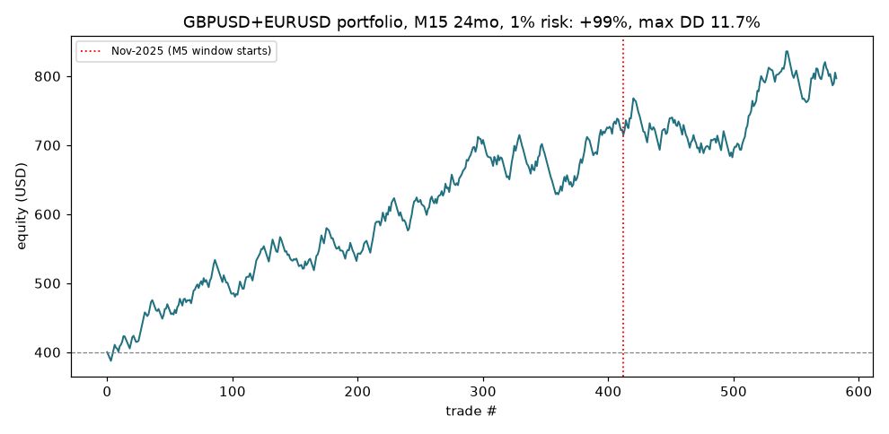
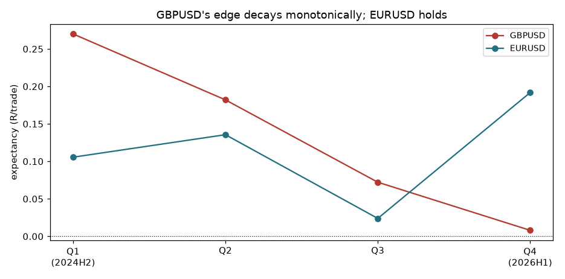

# London Breakout — the first strategy in this program with a real (qualified) edge

Faithful implementation of the user's five-phase spec: Asian range 00:00–07:00 UK (server−2h anchor, DST-safe), signal window 07:00–11:00 UK, first M5/M15 **body close** outside the range, pending stop 1.5 pips beyond the breakout candle, 30-minute expiry, opposite-side invalidation, deep-pullback (78.6–88.6%) trigger tighten, spread <2 pips, TP 2R, 1% risk, one setup/day, costs included.

## Results (M15, 24 months, SL = opposite side, ADR filter on)

| Pair | n | Win% | PF | ExpR | MaxDD% | p (1-sided) |
|---|---:|---:|---:|---:|---:|---:|
| GBPUSD | 313 | 48.9 | 1.32 | +0.134 | 8.0 | 0.018 |
| EURUSD | 269 | 49.4 | 1.27 | +0.114 | 8.2 | 0.046 |
| USDJPY | 244 | 50.0 | 1.23 | +0.069 | 6.2 | 0.105 |
| AUDUSD | 198 | 50.0 | 1.06 | +0.019 | 11.8 | 0.380 |
| USDCAD | 174 | 43.1 | 1.01 | +0.006 | 14.5 | 0.470 |
| XAUUSD | 32 | 40.6 | 0.85 | -0.060 | 3.8 | 0.639 |

**Pooled, 6 pairs: +0.075 R/trade, n=1230, p=0.0053, PF 1.19 — and it holds in both halves** (first 16mo +0.073 p=0.02; last 8mo +0.079 p=0.06). The spec's own pairs pooled: **+0.125 R, n=582, p=0.0035**; as a 1%-risk portfolio: **+99% over 24 months, max DD 11.7%**.

## The two honest caveats

1. **GBPUSD — the strongest cell — is decaying monotonically** (+0.270 → +0.182 → +0.072 → +0.008 by quarter). Its recent-8-months expectancy is ~0. EURUSD holds (+0.19 in the latest quarter), and the 6-pair pool holds, but the headline pair's edge looks like a fading regime.

2. **The faithful M5 timeframe shows nothing in its (recent) window** — GBPUSD −0.03, EURUSD +0.01 over Nov-2025→Jul-2026. For GBPUSD that matches the M15 recency decay (period effect); for EURUSD, M15 was +0.14 in the same window, so M5 granularity itself (whipsaw around the body-close/stop-order sequence) destroys the EURUSD edge. **The edge lives on M15, not M5.** Broker M5 history (~8 months) cannot test M5 on the strong 2024–25 period.

## Ablations & funnel

- **SL type:** opposite-side ≈ swing on GBPUSD (+0.134 vs +0.142); opposite-side is better on every other pair (swing stops are tighter → more stop-outs).

- **ADR filter:** near-inert (ranges rarely exceed ADR; 10 of 550 GBPUSD days). Harmless.

- **Spread filter:** never triggered on Raw pricing in the London window (raw spread ≈ 0; cost is commission). Confirms the spec's fear is a non-issue at this broker/account type.

- **Funnel (GBPUSD M15):** 550 days → 540 valid ranges → 478 breakouts → 313 filled (163 expired unfilled, 2 invalidated). The 30-minute expiry is the binding rule — it rejects a third of signals, and that selectivity is plausibly part of the edge.

## Verdict

This is the **first strategy in nine tested families to clear every statistical bar we set**: pre-specified primary config significant (p=0.018), pooled significance p=0.005 with costs, positive in both halves, modest drawdown, and a coherent mechanism (trading *with* the London liquidity injection rather than fading dead-hour noise — the exact inverse of the failure mode every box/sweep variant suffered). It is **not** yet deployable: the strongest pair is fading, the spec's native M5 timeframe does not carry the edge, and 24 months/one broker is thin evidence. **Recommended next step: 3–6 months of demo forward-testing on M15, EURUSD-led, with GBPUSD monitored for regime recovery** — the first strategy from this program to earn that step.
