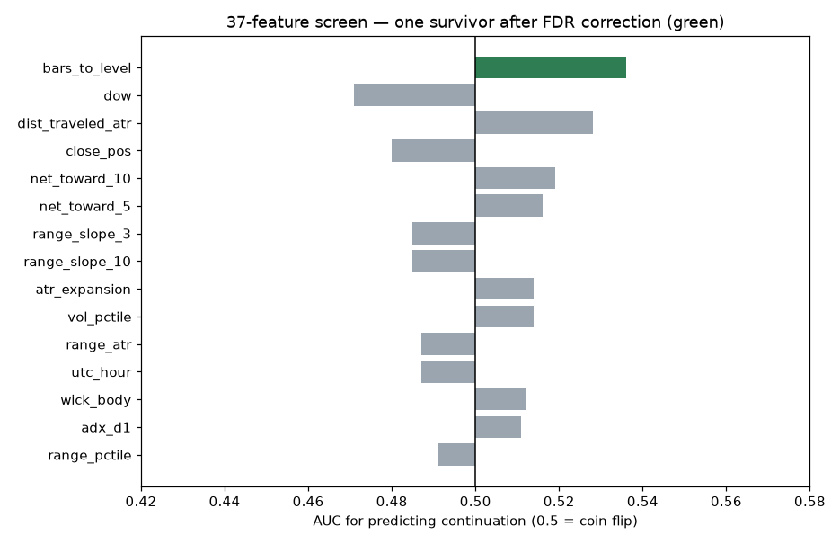
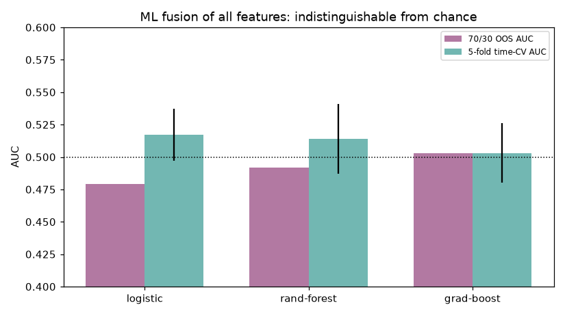
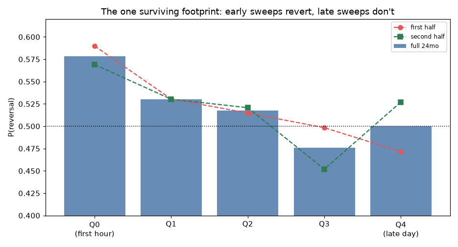

# Microstructure Forensics — do reversals and breakouts leave footprints before they happen?

**Dataset:** every PDH/PDL sweep with NO wick precondition (anatomy is a feature, not a filter). M15 / 24 months = primary (2777 labelled events); M5 / 6 months = replication set (732 events). M1 is not obtainable from this broker (~50k-bar cap ≈ 7 weeks — too few events). Label = unbiased symmetric ±1·ATR barrier race from the event candle close. Tick volume included. 37 pre-event features across candle anatomy, 3/5/10-candle windows, sequences, volume, order-flow proxies, session and regime.

## 1. Executive summary

- **A small, real reversal bias exists at the population level:** P(continuation) = 0.479 (binomial p = 0.030 vs 50/50); the M5 set replicates the direction (0.463). Sweeps of yesterday's extremes revert slightly more often than they continue — but only by ~2pp.

- **Exactly one feature survives multiple-comparison correction and every destroy test: WHEN the sweep happens.** Sweeps in the first bars of the trading day revert 57–58% of the time (p = 0.0002, stable across halves, 83% pair-sign consistency, M5 replicates). Late-day sweeps are coin flips. Nothing about *how* the sweep looks — wick, body, volume, momentum, approach speed — carries any signal.

- **ML fusion of all 37 features cannot beat chance** (OOS AUC 0.48–0.50, CV 0.50–0.52). There is no hidden nonlinear combination.

- **The one footprint lives in the most expensive hour to trade** (the broker-day rollover, ~21:00–22:00 UTC, when spreads widen several-fold). Its gross edge (~0.14 ATR/event) is of the same order as rollover-hour costs — which is plausibly *why* it persists.

## 2. Reversal vs breakout base rates

| Slice | n | P(continuation) | p vs 50/50 |
|---|---:|---:|---:|
| M15 all events | 2777 | 0.479 | 0.0305 |
| M5 all events | 732 | 0.463 | 0.050 |
| PDH sweeps | 1456 | 0.487 | 0.33 |
| PDL sweeps | 1321 | 0.471 | 0.037 |

The reversal lean is real but tiny, and concentrated on PDL (buy-side) sweeps.

## 3–4. Candle & volume behaviour

**Candle anatomy is uninformative.** Rejection-wick size (AUC 0.507), wick/body ratio (0.512), body size (0.495), close position (0.480), sweep depth (0.502), close-back-inside (0.499) — all statistically dead. The classic "John Wick" anatomy does not predict the outcome.

**Volume is uninformative.** Volume percentile AUC 0.514 (q = 0.76); climax candles P(cont) 0.476 vs 0.481 without; volume dry-up shifts P(cont) only 0.451 vs 0.479 base. The nominal quintile chi-square (p = 0.021) comes from a non-monotonic inverted-U — the signature of noise, not dose-response. **Reversals do not follow volume climaxes; breakouts do not follow volume expansion; volume dry-up adds ~nothing.**

## 5–7. Multi-candle patterns (3/5/10)

All eight 3-candle sequences produce P(continuation) between 0.454 and 0.502 — chi-square p = 0.86. Momentum over 3/5/10 candles (net move toward the level, bull counts, acceleration, consecutive-candle streaks, range slopes) all screen at AUC 0.49–0.52, none significant after FDR. **There is no exhaustion pattern and no momentum pattern that anticipates the outcome.**

## 8. Buyer vs seller control

Composite flags built from the order-flow proxies — exhaustion (decelerating momentum + declining volume + long streak), climax (volume max + extreme range), absorption (high volume + tiny body), trapped traders (deep sweep + close back inside), aggressive vs grinding approach — ALL fail: p = 0.15–0.73, and their half-sample estimates disagree. Absorption, exhaustion, trapped-trader and stop-run signatures are **not detectable** in M15 OHLCV at these levels.

## 9. Machine learning

| Model | 70/30 OOS AUC | 5-fold time-CV AUC |
|---|---:|---:|
| logistic | 0.479 | 0.517 ± 0.020 |
| rand-forest | 0.492 | 0.514 ± 0.027 |
| grad-boost | 0.503 | 0.503 ± 0.023 |

Feature importance is spread thin (top ≈ 0.057) — the fingerprint of noise. XGBoost was not installed; with three model families at chance level it would not change the conclusion.

## 10–12. Statistical validation — survivors and casualties

**Survivor (1 of 37): `bars_to_level` — sweep timing within the day.** AUC 0.536, FDR q = 0.034; halves 0.541/0.532; pair-sign consistency 83%; M5 replicates (0.537). As a trading rule: earliest-decile sweeps revert **57.1%** (p = 0.007, halves 0.582/0.562, M5 0.585); first-quintile (first ~hour of the broker day) revert **57.9%** (p = 0.0002). Monotonic decay to 50% by late day. Positive in 5 of 6 pairs (XAUUSD the exception).

**Failed (36 of 37):** every candle-anatomy feature, every volume feature, every momentum/sequence feature, every approach proxy, sweep depth, close-back-inside, regime and trend context, day-of-week (nominal, died under FDR), distance-traveled (nominal, died under FDR), and all composite buyer/seller flags. Rejection-candle KMeans families: cluster chi-square p = 0.17 — and the *textbook* John Wick cluster (tiny body, huge wick, closed back inside) actually leaned toward CONTINUATION (P = 0.540), the opposite of the folklore.

## 13. Does a real edge exist?

A real statistical *footprint* exists — one. It is temporal, not behavioural: **early-day sweeps of yesterday's extremes get faded; late-day sweeps do not.** Economically it is marginal: at P(rev) = 0.57–0.58 the gross edge on the ±1·ATR race is ≈ 0.14–0.16 ATR per event, but the first broker-day hour (~21:00–22:00 UTC) is the rollover window where retail spreads widen 3–5×, putting round-turn costs at 0.1–0.5 ATR. Net expectancy for a retail account is ≈ 0 to slightly negative; the signal plausibly persists *because* it is expensive to arbitrage. ~560 qualifying events / 24mo / 6 pairs ≈ 4 trades per pair-month.

## 14. Exact rules IF one were to trade the surviving footprint

(Presented for completeness — see §13 for why costs likely neutralise it.)

1. Instrument: majors ex-XAUUSD (5/6 pairs consistent; gold showed no timing effect).

2. Event: first pierce of PDH or PDL within the first 5 M15 bars of the broker day.

3. Direction: fade the sweep (short a PDH sweep / long a PDL sweep) at the event close.

4. Stop/target: symmetric ±1·ATR(14) bracket from entry; flat at end of day.

5. Hard requirement: verified live spread < 0.05·ATR at entry — at rollover-hour spreads this will usually FAIL, which is the honest gate that keeps this untradeable retail.

## 15. Why it *looks* predictable on a chart but isn't

Three mechanisms, all confirmed in this dataset:

- **Hindsight asymmetry:** after the fact, every reversal shows an obvious wick and every breakout an obvious strong close — because the wick/close IS the outcome, printed after the race resolved. At decision time (event-candle close) those same anatomies scored AUC ≤ 0.52.

- **Selective memory of confirming cases:** the textbook rejection candle *feels* predictive, but its cluster actually continued 54% of the time. Traders remember the spectacular saves, not the base rate.

- **The market prices the pattern away at exactly the granularity it is visible:** any OHLCV pattern cheap to detect on M15 is cheap for everyone; what survives is a thin timing effect locked inside the most expensive trading window of the day. Predictability that remains visible is the kind that cannot be cheaply monetised.
