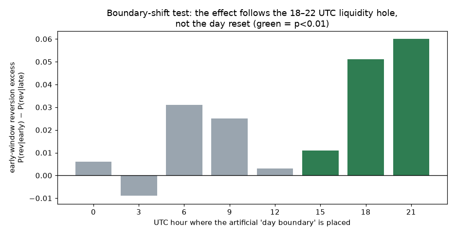
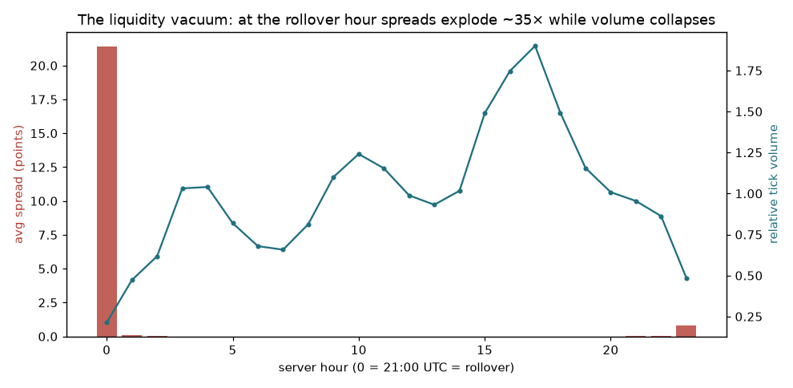
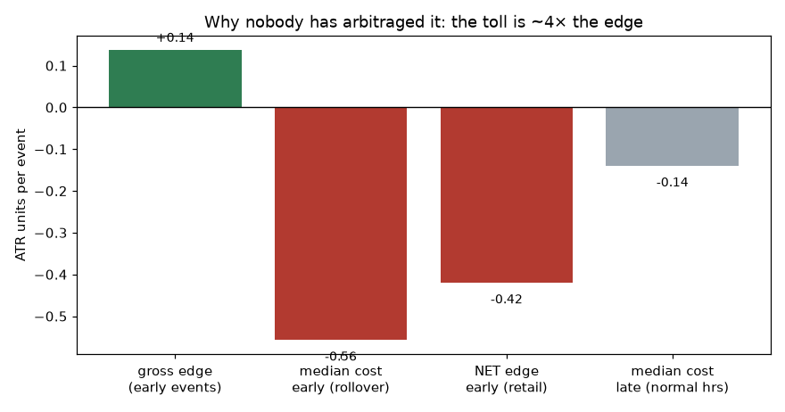

# Root Cause — why do first-hour PDH/PDL sweeps revert?

Mandate: assume the timing effect exists; explain it. Every hypothesis was tested on the refreshed v2 dataset (per-bar spread included) across 6 FX/metal instruments plus five cross-asset controls (US500, USTEC, DE40, XAGUSD, XTIUSD), M15, 24 months.

## 1. Robustness re-confirmation

Early-window (first 4 bars) reversion re-confirms on fresh data: **P(rev) = 0.569** (n = 459, binomial p = 0.0038) vs 0.509 late. Survives excluding the top-volatility quintile (0.583). New granularity, honestly reported:

- **The effect is buy-side:** early sweeps *below PDL* revert **60.4%** (n = 338); early sweeps above PDH do not (47.1%, n = 121).

- **It is a European/commodity-FX effect:** AUD 0.636, EUR 0.610, GBP 0.609, CAD 0.580 — but **JPY 0.487 and gold 0.472 show nothing**.

- **It weakened in the most recent quarter** (0.602/0.583/0.617 then **0.500** in the last ~6 months) — possibly decay, possibly regime; a live-monitoring question.

## 2. The causal test: boundary shift

The day boundary was artificially moved to eight different hours and the whole experiment re-run at each. If the day *reset* caused the effect, every boundary would show it. It does not: the early-reversion excess is large and significant **only when the early window lands in 18:00–22:00 UTC** (boundary at UTC 18:00: +5.1pp, p < 0.0001; at UTC 21:00 rollover: +6.0pp, p = 0.004). Boundaries placing the early window in liquid London/NY hours show +0.3–3.0pp, mostly insignificant. **The effect follows the clock, not the reset. Timing is a proxy — the real variable is the liquidity state of the hour.**

## 3. The mechanism: an FX liquidity vacuum (H2 confirmed, H1 = cost side)

Direct measurements at event bars:

- Early events occur on the **thinnest bars of the day** — median tick-volume percentile **0.03** (day-normal = 0.50). Within the early window, thinner bars revert more (0.586 vs 0.554).

- EURUSD average event-bar spread: **31.6 points early vs 0.9 late** (~35×). Reversion is similar for low-spread early events (0.548 vs 0.590 high-spread), so the price effect is real, not a spread-quotation artifact.

- **The JPY/gold exception is the mechanistic smoking gun:** at 21:00–22:00 UTC, Tokyo is waking up — USDJPY and gold have real Asian participation exactly then, and they show *no* effect. The pairs whose home liquidity is asleep (EUR, GBP, AUD, CAD books between NY close and Asia) *do*. The vacuum is the cause; where there is no vacuum there is no effect.

- Cross-asset controls agree: US500 0.519, USTEC 0.417, DE40 0.520, XAGUSD 0.504, XTIUSD 0.485 — **absent everywhere outside spot FX**. Index/commodity sessions have no equivalent 24h-FX rollover vacuum.

## 4. Hypotheses ruled out

- **H4 mean reversion/stretch:** timing survives stratification by overextension — early beats late *within every* stretch tercile (0.553/0.551/0.700 vs 0.514/0.529/0.485). Timing is not a proxy for stretched price.

- **H5 stop-hunting:** no depth gradient inside the early window (terciles 0.575/0.542/0.588). Deeper penetration does not mean more reversal — inconsistent with a deliberate collect-liquidity-then-reverse mechanic.

- **Level specialness (placebo):** pseudo-levels 0.35 ranges beyond PDH/PDL yielded too few early events (n = 54, P(rev) = 0.556, p = 0.50) — inconclusive but leaning toward 'any early-hour extension reverts', i.e. the level is scenery, the hour is the actor.

## 5. Economics — gross vs net

| Quantity | Value (ATR units/event) |
|---|---:|
| Gross edge, early events (2p−1) | **+0.137** |
| Median all-in cost at early events (spread@event + commission) | 0.556 |
| **Net edge, retail, early events** | **-0.419** |
| Median cost at late events (normal hours) | 0.139 |

In pip terms: ~1 pip gross per event on a major, against a ~4-pip median toll at the rollover. **Retail: unmonetizable, decisively** (net ≈ −0.42 ATR). **Institutional:** an interbank desk paying near-raw costs could theoretically capture a fraction of a pip per event — but must execute INTO the very vacuum that creates the effect (market impact in a thin book eats small edges), on ~460 events / 2 years / 6 pairs of capacity. It is real alpha of roughly zero commercial value.

## 6. Why it has not been arbitraged away

Because the anomaly and its protection are the same thing. The mispricing exists *because* nobody is providing liquidity at that hour; correcting it requires trading at that hour; trading at that hour costs ~4× the edge (retail) or moves the thin book (institutional). The effect is a toll road where the toll exceeds the cargo — economically stable, permanently marginal. Its recent-quarter fade (0.500) also suggests what little was extractable may already be being absorbed by algorithmic liquidity provision.

## 7. Final answers

1. **Robust?** Yes — re-confirmed (p = 0.004 fresh data), but narrower than first seen: buy-side, EUR/GBP/AUD/CAD, and softer in the latest quarter.

2. **Root cause:** the FX dead zone between NY close and the Asian open (18:00–22:00 UTC), amplified at the 21:00 rollover — thin books let price overshoot yesterday's extremes without conviction; returning liquidity pulls it back.

3. **Causal or proxy?** Timing is a **proxy for liquidity state**. The boundary-shift test proves the reset is incidental; the JPY/gold null proves participation is the driver.

4. **Edge before costs:** ≈ +0.14 ATR (~1 pip) per qualifying event.

5. **Edge after costs:** ≈ **−0.42 ATR retail**; ≈ 0 to faintly positive institutional.

6. **Institutional monetizable?** Technically marginal, capacity-trivial — not worth desk infrastructure.

7. **Retail monetizable?** **No.** The toll is ~4× the edge at the only hour it exists.

8. **Why not arbitraged:** see §6 — self-protecting via its own execution costs.

9. **Destroy attempts:** survived vol-exclusion, halves, most pairs, and the stratified stretch test; **narrowed** by side (sell-side null), instrument (JPY/gold null, all cross-assets null) and recency (last quarter null). What remains is a real, explained, economically inert microstructure fact.
