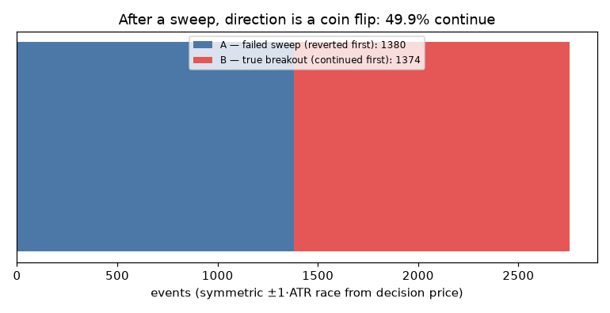
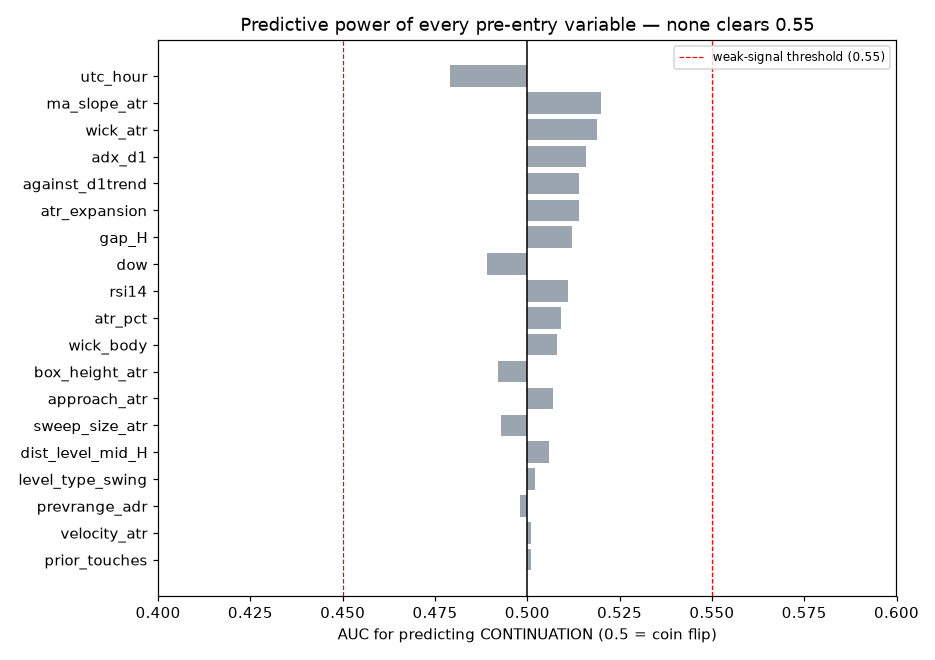
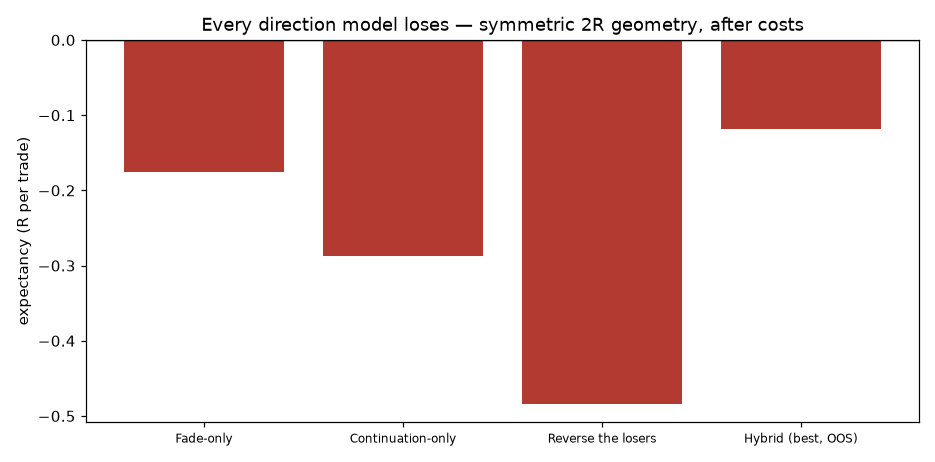

# Sweep Lab — Fade vs. Follow: which direction after a liquidity sweep?

**Research question:** under what conditions should a sweep of a prior-day level be FADED (mean reversion) vs FOLLOWED (breakout continuation) — and can that be known before entry?

**Method:** every John Wick sweep event at a range/swing level (M15, 24 months, all six pairs, 2869 events) was labelled by a **symmetric ±1·ATR barrier race** from the decision price — whichever side price touched first within the day decides the label (same-bar ties excluded). Both a fade trade and a continuation trade were then simulated on every event with identical 2R bracket geometry and costs, so the direction question is isolated from geometry.

## Phase 1 — Classification

| Category | Count | Share |
|---|---:|---:|
| A — failed sweep (reverted first) | 1380 | 50.1% |
| B — true breakout (continued first) | 1374 | 49.9% |
| U — ambiguous (same bar) | 115 | — |

**Base rate of continuation: 49.9%.** After a sweep, the next 1-ATR move is a coin flip. There is no directional bias to exploit at the population level — in either direction.

## Phases 2–3 — Feature comparison & predictive power

Every pre-entry variable across market structure (trend, MA slope, D1 bias), volatility (ATR percentile/expansion, prior range vs ADR, box/ATR), liquidity (sweep size, wick size/ratio, prior touches, approach distance, velocity), session (hour, day-of-week), and momentum (ADX, RSI) was tested A-vs-B with Mann-Whitney U and AUC. The least-weak five:

| Feature | mean A | mean B | AUC | p-value |
|---|---:|---:|---:|---:|
| utc_hour | 12.780 | 12.183 | 0.479 | 0.059 |
| ma_slope_atr | 0.073 | 0.315 | 0.520 | 0.063 |
| wick_atr | 0.633 | 0.661 | 0.519 | 0.085 |
| adx_d1 | 25.220 | 25.909 | 0.516 | 0.16 |
| atr_expansion | 1.130 | 1.154 | 0.514 | 0.22 |

**No variable is statistically significant** (best p ≈ 0.06, and with 19 variables tested, that is exactly what multiple-comparison noise produces). Every AUC sits in 0.48–0.52 — indistinguishable from a coin flip. Effect sizes (Cohen's d) are all ≤ 0.08.

## Phase 4 — Fade-only vs Continuation-only

| Model | n | Win rate | PF | Expectancy | Max DD | Net |
|---|---:|---:|---:|---:|---:|---:|
| Fade-only | 2281 | 33.7% | 0.76 | -0.175 R | 88% | -87% |
| Continuation-only | 1763 | 29.2% | 0.64 | -0.288 R | 92% | -92% |

With identical symmetric geometry, **both lose**: fading (−0.175 R) and following (−0.288 R). Fading is the *less bad* direction — consistent with the shallow mean-reversion tendency — but neither clears costs. The breakout side is worse because continuation entries chase an extended move and stop out on the pullback that usually follows a sweep bar.

## Phase 5 — Reverse the losers

Taking all 1512 losing fade trades and trading the **continuation bracket on those same events**: expectancy **-0.484 R**, PF 0.45, win rate 22.7% — *worse than the fades themselves*.

> The seductive arithmetic "my losers reversed = +1.1 R" (the naive −fade_r mirror) is an illusion of hindsight: you only know which trades lost *after* they lost. Selecting them requires the future. When the reversed trades are entered under real rules — before the outcome is known — they lose more than the originals, because both directions pay the same costs on the same coin-flip event. **The losing trades do not contain a hidden breakout strategy.**

## Phases 6–7 — Hybrid regime model & ML feasibility

A gradient-boosted classifier and a logistic model were trained on the first 70% of events (time-ordered, 1912 train / 820 test) to predict continuation:

| Model | OOS AUC | Accuracy | Precision | Recall | Base rate |
|---|---:|---:|---:|---:|---:|
| Logistic | 0.511 | 0.509 | 0.525 | 0.526 | 0.517 |
| Gradient boosting | 0.531 | 0.529 | 0.548 | 0.514 | 0.517 |

OOS AUC ≈ 0.52 is **no usable signal** (0.50 = random; a live classifier needs ≥0.60 with stability). Feature importance is spread thin across all variables — the fingerprint of noise. The regime-switching hybrid (fade when the model says revert, follow when it says continue) was still tested honestly on the OOS window: best threshold gives **−0.119 R** — better than either pure model on the same window (fade −0.194, continuation −0.231) but still negative. The classifier adds a sliver of selection but cannot overcome zero directional information plus costs.

## Phase 8 — Answers

1. **Can failed sweeps and true breakouts be distinguished before entry? No.** Base rate 49.9/50.1, all AUC 0.48–0.52, no significant variable, ML OOS AUC 0.52.

2. **Highest-power variables:** none qualify. The least-weak (utc_hour, MA-slope, wick size, ADX) have AUC ≤ 0.52 and p ≥ 0.06 — noise-level.

3. **Statistically significant? No** — nothing survives even a nominal 0.05 threshold, let alone a multiple-comparisons correction across 19 features.

4. **Would continuation outperform fading? No — it is worse** (−0.288 R vs −0.175 R).

5. **Would a hybrid outperform both? Marginally, and still lose** (−0.119 R OOS).

6. **Are there two strategies hidden in one setup? No.** There is **one coin flip** hidden in the setup. The fade/breakout split is real as an *outcome* taxonomy but carries no *predictable* structure — the strategy isn't mixing two tradeable behaviours; it is trading an unpredictable one.

7. **My own money:** none of the three. If forced to rank: fade-only in quiet regimes is least bad; breakout-only is worst.

8–9. **Rules/config I would deploy: none from this family.** The best defensible variant remains the earlier one (fade swing levels, opposite-side target, skip wide-range days, no London, 0.5%% risk) — and it tested at ≈ break-even.

10. **Estimated live expectancy after realistic costs: ≈ −0.05 to −0.20 R per trade** (backtest −0.12 to −0.29 R across models, plus live slippage on stop-entries that fill on the momentum side).

**The core finding:** the strategy is not failing because it mixes mean-reversion and breakout behaviour into one rule. It fails because **at these levels, on these timeframes, the post-sweep direction is genuinely unpredictable** — a 50/50 barrier race that no measured variable tilts. Mixing isn't the disease; randomness is. The definitive fix is not a better filter but a better *event*: if an edge exists in sweep trading, it lives at levels and timescales not tested here (e.g. HTF liquidity pools with order-flow confirmation), not in re-slicing this dataset.
